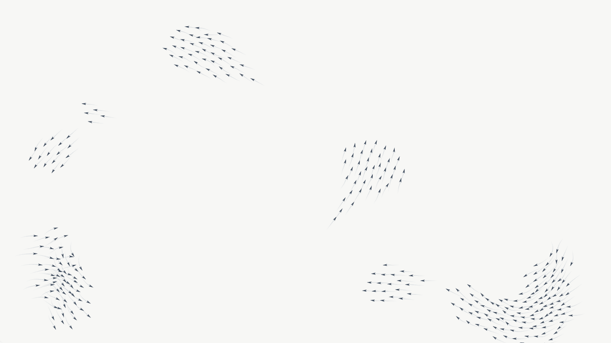
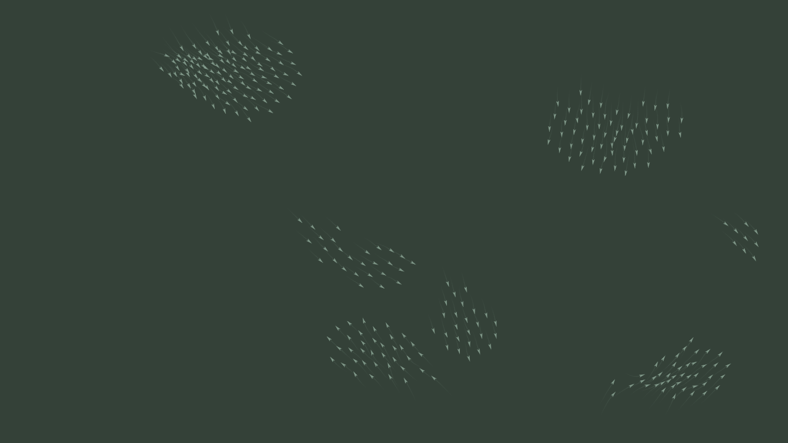

# dandan-wallpaper

一个安静的鸟群动态壁纸。几百只小鸟按 Boids 算法飞行，自己聚成群、散开、再汇合。纯 HTML + Canvas，没有任何依赖，配合 [Lively Wallpaper](https://github.com/rocksdanister/lively)（免费开源）当 Windows 桌面壁纸。

| 护眼白 | 深灰绿 |
|---|---|
|  |  |

## 特点

- **两套配色**：护眼白（`#f7f7f5`，不刺眼也不发黄）和深灰绿（`#344138`）。
- **算法**：分离、对齐、聚合三条规则，加边缘柔性转向。用空间网格找邻居，320 只鸟也很流畅。
- **尾迹**：每只鸟保留最近 16 个位置，越旧越淡，背景始终保持干净。
- **互动**：鼠标移动会吸引鸟群，按住左键驱散。壁纸模式下鼠标通常点不到，不影响显示。

## 在新电脑上安装

### 1. 安装 Lively Wallpaper

任选一种：

```powershell
winget install -e --id rocksdanister.LivelyWallpaper
```

如果从 GitHub 下载太慢，改用微软商店版：

```powershell
winget install -e --id 9NTM2QC6QWS7 --source msstore
```

装好后启动一次 Lively，让它生成壁纸库目录。

### 2. 安装壁纸

```powershell
git clone https://github.com/hhh-dahah/dandan-wallpaper.git
cd dandan-wallpaper
powershell -ExecutionPolicy Bypass -File .\install.ps1
```

没装 git 的话，在 GitHub 页面点 `Code → Download ZIP`，解压后在文件夹里运行同样的最后一行命令。

脚本会把 `wallpaper/` 复制到 Lively 的壁纸库（商店版和安装包版都能识别），并重启 Lively 让它重新扫描。

### 3. 应用

打开 Lively，在「库」里找到「鸟群 Boids」，点击即可设为桌面壁纸。

## 切换配色

- **在 Lively 里**：点壁纸卡片上的自定义（滑块）图标，选「配色」。
- **在浏览器里预览**：直接打开 `wallpaper/index.html`，按 `1`（护眼白）、`2`（深灰绿），或按 `T` 来回切换。选择会被记住。
- **地址参数**：`index.html?theme=green` 或 `?theme=white`。

## 为什么不能直接用 Lively 的「+」添加

`wallpaper/` 里已经带有 `LivelyInfo.json`，Lively 会认为它是打包好的壁纸，用「+」导入会报错：

> A LivelyInfo.json file was found in this project folder. It looks like this project is already packaged.

所以要用上面的 `install.ps1`，它是直接把文件放进壁纸库。

## 调整

都在 `wallpaper/index.html` 里：

| 想改什么 | 改哪里 |
|---|---|
| 鸟的数量 | `const N = 320` |
| 尾迹长度 | `TRAIL = 16` |
| 避让距离 / 感知范围 | `SEP` / `VIEW` |
| 颜色 | `THEMES` 对象里的 `bg`、`bird`、`trail`、`trailA` |

改完重新运行 `install.ps1` 即可更新到 Lively。

## 目录

```
dandan-wallpaper/
├── install.ps1          一键安装到 Lively 壁纸库
├── wallpaper/
│   ├── index.html       壁纸本体
│   ├── LivelyInfo.json  Lively 壁纸描述
│   └── LivelyProperties.json  自定义面板里的「配色」下拉菜单
└── docs/                预览图
```

## 常见问题

- **库里找不到壁纸**：确认已启动过一次 Lively，再重新运行 `install.ps1`。脚本会重启 Lively。
- **没有缩略图**：这是预期的，壁纸没有附带缩略图，不影响使用。
- **全屏时占资源吗**：Lively 默认在全屏应用或游戏运行时暂停壁纸，所以不占显卡。
